

  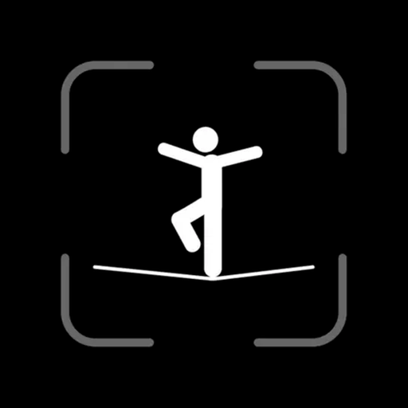

<h1 align="center">Wazen · وازن</h1>

  <strong>Cross-Platform Native AI Nutrition, Meal Vision, Diabetes CGM &amp; Fitness Platform</strong> 
  <em>Native iOS (SwiftUI + watchOS + WidgetKit) &bull; Native Android (Kotlin + Jetpack Compose + Health Connect) &bull; Django REST &amp; Cloudflare Edge</em>

  <a href="https://wazenai.com"><strong>🌐 Website (wazenai.com)</strong></a> &nbsp;&bull;&nbsp;
  <a href="https://apps.apple.com/app/wazen-%D9%88%D8%A7%D8%B2%D9%86/id6760981534"><strong>🍎 App Store (iOS 17.6+)</strong></a> &nbsp;&bull;&nbsp;
  <a href="https://play.google.com/store/apps/details?id=com.wazen.health.wazen_app"><strong>🤖 Google Play (Android 8.0+)</strong></a>

  
  
  
  
  
  

  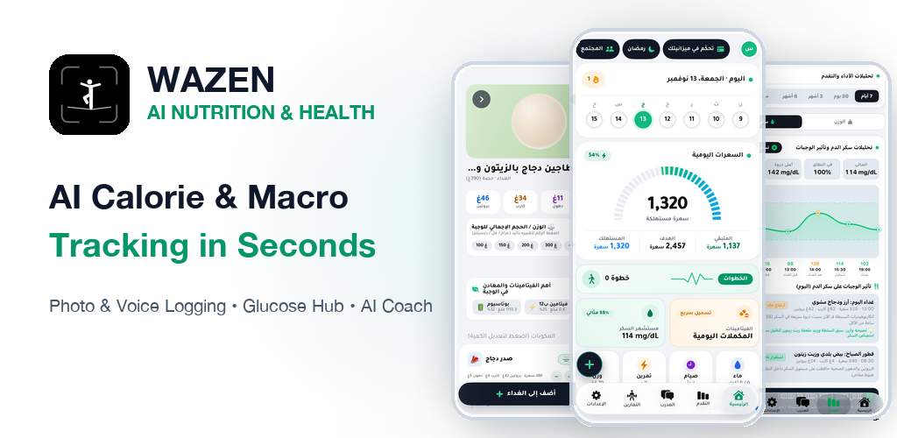

> [!NOTE]
> **Portfolio & Architecture Showcase:** Wazen is a shipped commercial production product on the [Apple App Store](https://apps.apple.com/app/wazen-%D9%88%D8%A7%D8%B2%D9%86/id6760981534) and [Google Play](https://play.google.com/store/apps/details?id=com.wazen.health.wazen_app). Source code is kept in a private repository; this public repository presents the product architecture, engineering scope, technology stack, and live UI showcase.

---

## 👤 Role & Project Scope

* **Role:** Full-Stack Mobile Architect & Product Engineer ([Salim Moussaoui](https://github.com/salimmous))
* **Production Platforms Shipped:** iOS App (`v2.0.2`), Apple Watch companion + WidgetKit extensions, Android App (`v7.9`), Django API server, Cloudflare Workers Edge AI gateway, and multilingual SEO/GEO web portal (`wazenai.com`).
* **AI-Accelerated Delivery:** End-to-end architecture, native dual-platform UI/UX parity, backend ingestion/queues, and automated release pipelines.

---

## 🚀 What Wazen Does (Core Capabilities)

### 1. 📸 AI Meal Vision, Portion Editing & Barcode Scanning
* **Instant Meal Recognition:** Captures food photos and decomposes dishes into structured ingredients, gram weights, calories, macros, fiber, vitamins, and minerals.
* **Regional & Mixed Cuisine Calibration:** Tuned specifically for complex Middle Eastern, North African, Gulf, Levantine, Egyptian, and international dishes (*Tagine, Couscous, Harira, Kabsa, Shawarma, Machboos, Koshari, home stews*) including cooking oils and hidden sauces.
* **Interactive Ingredient & Gram Editor:** Quick-edit numbered pins, inline weight stepper presets, drink/main meal flows, and oil/sauce adjustments in one tap.
* **Barcode (`GTIN`) Scanner:** Native camera scanning (`CameraX` + `ML Kit` on Android, `AVFoundation` on iOS) with packaged ingredient breakdown.

### 2. 💬 Real-Time Voice, Text & Coach Telemetry
* **Conversational AI Nutrition Coach:** Bidirectional voice and text chat grounded in the user's actual calorie budget, weight trend, macros, and workout logs.
* **Natural Language Meal Logging:** Log meals by voice or free-text descriptions across **5 supported languages** (`Arabic RTL`, `English`, `French`, `German`, `Spanish`).
* **Multi-Model Routing:** Hosted Cloudflare Workers AI gateway (`TypeScript`, streaming audio & vision payloads, credit/usage ledger) alongside user-configurable provider routing (`LiteRTLM` on-device + cloud models).

### 3. 🩸 Diabetes & Blood Glucose Hub (CGM + Safe Fasting)
* **Daily Glucose Telemetry:** Live CGM trend summary (`mg/dL`, Time-in-Range `%`, min/peak metrics) and manual fingerstick logging synced via **Apple HealthKit** & **Android Health Connect**.
* **Meal-Spike Attribution:** Correlates post-meal glycemic rises with exact logged meals and provides actionable nutritional guidance.
* **Safe Fasting, Ramadan Mode & Companion Alerts:** Built-in intermittent fasting & Ramadan schedules with safety thresholds, daily vitamin/supplement tracking, and caregiver/companion emergency notifications.

### 4. 🏋️ Workouts Library, Smart Budget & Community
* **875+ Illustrated Exercises:** Categorized by muscle group, equipment, and difficulty with full Arabic instructions, in-app exercise video playback, sets/reps/RPE tracking, and burnt-calorie syncing.
* **Smart Food Budget & Grocery Planner:** Generates balanced meal plans calibrated to a daily food budget and regional currency.
* **Wazen Community & Ecosystem Integration:** Community feed, Apple Watch standalone companion (`watchOS`), Interactive Lock Screen / Home Screen widgets (`WidgetKit` & Android `Glance`), local push reminders (`WorkManager` / `FCM` / `APNs`).

---

## 📱 Product Showcase (Live Light-Mode UI)

<table align="center">
  <tr>
    <td align="center" width="25%">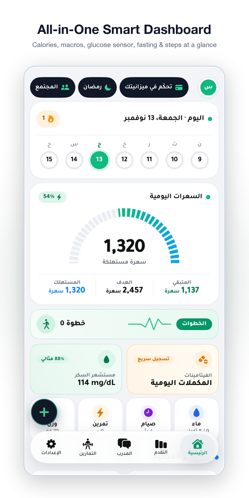 <b>1. Home Dashboard</b></td>
    <td align="center" width="25%">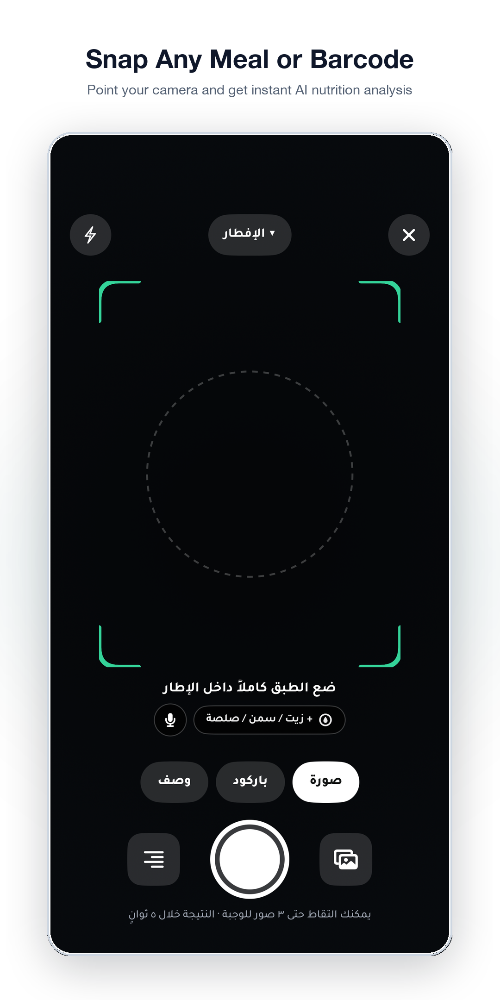 <b>2. AI Camera &amp; Barcode</b></td>
    <td align="center" width="25%">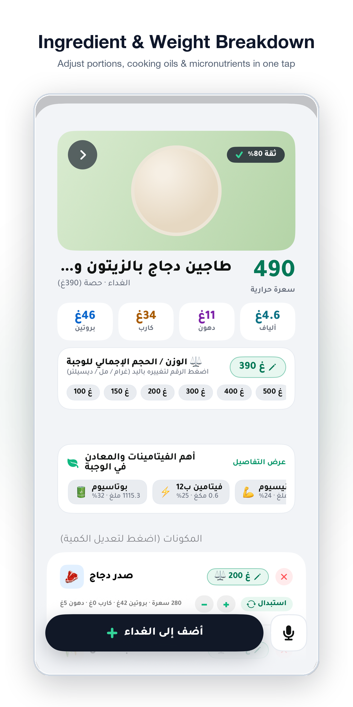 <b>3. Meal Breakdown</b></td>
    <td align="center" width="25%">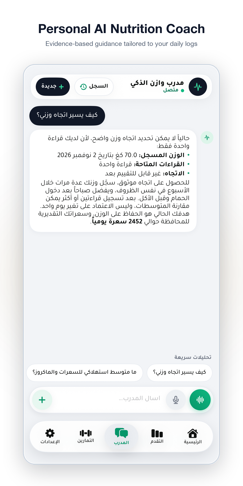 <b>4. AI Coach</b></td>
  </tr>
  <tr>
    <td align="center" width="25%">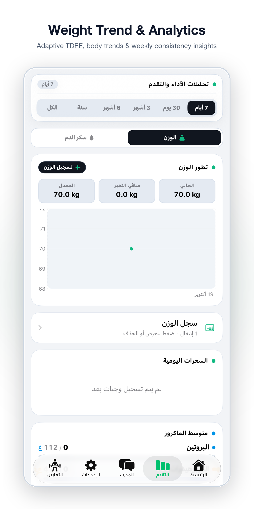 <b>5. Progress &amp; Trends</b></td>
    <td align="center" width="25%">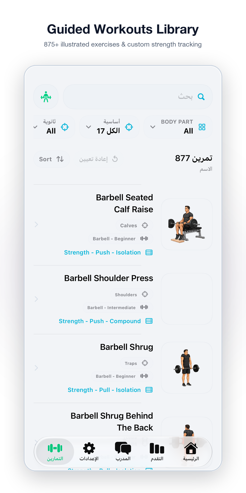 <b>6. Workouts (877+)</b></td>
    <td align="center" width="25%">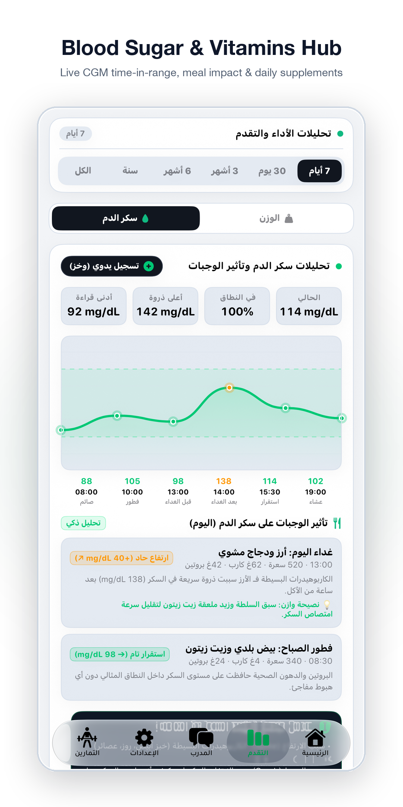 <b>7. Glucose &amp; CGM Hub</b></td>
    <td align="center" width="25%">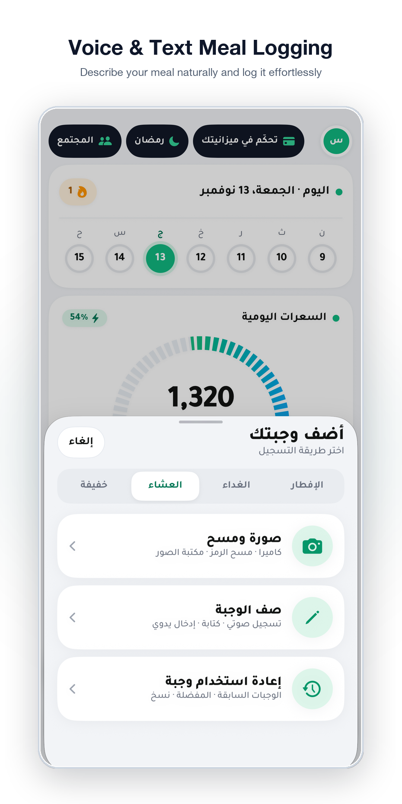 <b>8. Voice &amp; Text Logging</b></td>
  </tr>
</table>

---

## 🏛️ System Architecture

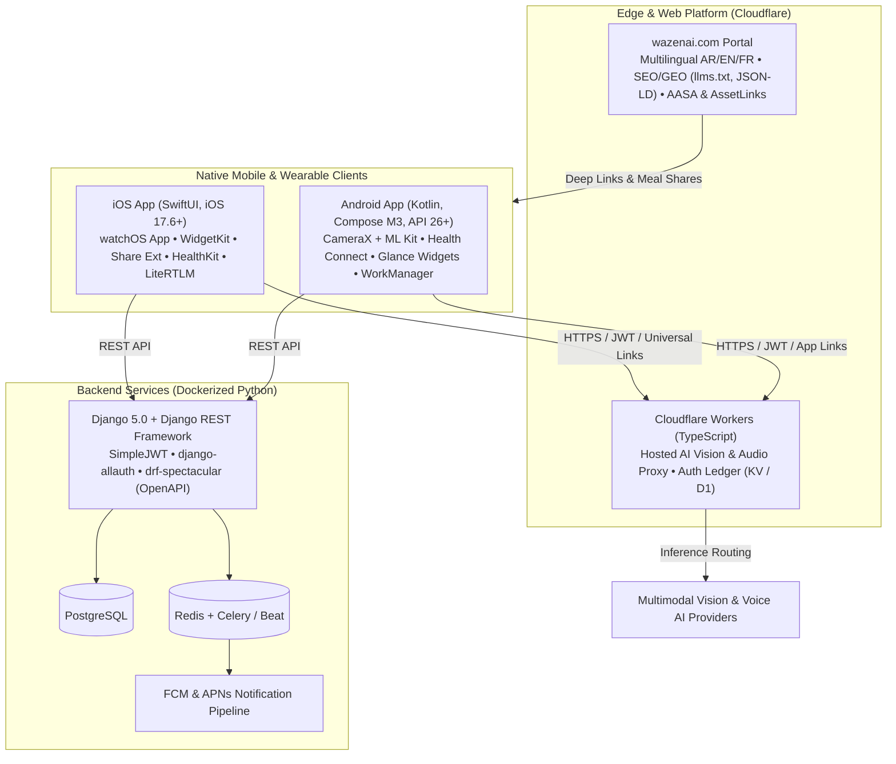

---

## 🛠️ Technology Stack

| Layer | Technologies Used |
| :--- | :--- |
| **iOS & Wearables** | Swift, SwiftUI (`iOS 17.6+`), `watchOS` Companion, `WidgetKit`, Share Extension, `HealthKit`, `AVFoundation`, On-device `LiteRTLM` |
| **Android** | Kotlin, Jetpack Compose (Material 3), `CameraX`, `ML Kit` Barcode (`GTIN`), `Health Connect`, `Glance` AppWidgets, `WorkManager`, Encrypted DataStore, `Coil`, `RevenueCat` SDK |
| **Edge / AI Gateway** | Cloudflare Workers (`TypeScript`), Wrangler, Cloudflare KV & D1 Migrations, Streaming Vision & Audio AI Proxy |
| **Backend API** | Python, Django `5.0.6`, Django REST Framework `3.15`, PostgreSQL (`psycopg2`), Redis, Celery & Celery Beat, Flower, JWT (`SimpleJWT`), `django-allauth`, `drf-spectacular`, `firebase-admin` / `fcm-django`, Docker Compose |
| **Web & Growth** | Multilingual HTML/CSS/JS (`wazenai.com` in `AR`, `EN`, `FR` + 8 regional landing pages), Schema.org JSON-LD, `llms.txt` / GEO, `hreflang`, Apple AASA & Android AssetLinks |
| **Localization** | Full RTL & LTR support across **Arabic, English, French, German, and Spanish** + automated multi-locale Play Store asset generator (`Pillow` + `arabic_reshaper` + `python-bidi`) |

---

## 🌍 نظرة مختصرة بالعربية

**وازن (Wazen)** تطبيق ذكي شامل للتغذية، حساب السعرات والماكروز، متابعة سكر الدم (CGM)، واللياقة البدنية متوفر رسمياً على [**App Store**](https://apps.apple.com/app/wazen-%D9%88%D8%A7%D8%B2%D9%86/id6760981534) و [**Google Play**](https://play.google.com/store/apps/details?id=com.wazen.health.wazen_app) وعلى الويب عبر [**wazenai.com**](https://wazenai.com).  
صُمّم وطُوّر ببنية متعددة المنصات (**SwiftUI / watchOS** لنظام iOS، و **Kotlin / Jetpack Compose** لنظام Android، مع **Cloudflare Workers** و **Django REST / PostgreSQL / Celery** في الواجهة الخلفية) لتقديم تجربة عربية وعالمية متكاملة بـ **5 لغات**.

> 📄 Ready-to-copy CV & LinkedIn resume bullet points: see [`CV_RESUME_BULLETS.md`](CV_RESUME_BULLETS.md).
